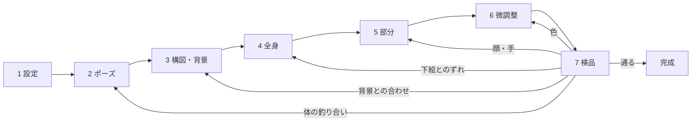

# 絵を描かせる流れ（工程と戻り先）

人物の絵は工程に分けて道具に描かせる。工程ごとに確かめ、落ちたらその工程だけをやり直す。
後の工程の検品で崩れが見つかったら、その崩れを受け持つ工程まで戻り、そこから先だけをやり直す。
1 回で全部を通すやり方では、手が崩れただけで良かった体まで描き直しになった（全直し）。

工程の道具は `tools/gen/pipeline.py`。試すたびに `<出力>/progress.html`（作業の様子の頁）を書き直し、
落ちた試しも絵と理由を残す。検品の前でも、どこまで進んだか・なぜ落ちたかを人が見られる。

## 工程

安い工程（人形、数十秒）で決められることは、高い工程（描く、数分）に入る前に決め切る。

| 工程 | やること | 確かめ | 落ちたとき | 費用 |
|---|---|---|---|---|
| 1 設定 | 設定資料集（体型・服・色・ジャンルの頭身） | 足りない欄 | 欄を埋める | 0 |
| 2 ポーズ | 人形の関節の角度を決めて下絵を写す | 体の決まり・可動域 | 角度だけ変えて写し直す | 約 30 秒 |
| 3 構図・背景合わせ | 人形を背景に置く（地平線・大きさ・光の向き） | 足元の高さ・遠近の大きさ・光の向き | 置き方だけ変える | 約 30 秒 |
| 4 全身を描く | 下絵の奥行きで形を縛って描く | 下絵との釣り合い・頭身・端の切れ | 種を変えて描き直す | 約 4 分 |
| 5 部分の描き直し | 顔・手・足・持ち物を、切り出して描き直す | 部分ごとの検品（目・指・靴の左右） | その部分だけ種を変える | 部分ごとに約 1 分 |
| 6 微調整 | 色・光のなじませ、細かな直し | 色のずれ・光の向き | その直しだけ | 数秒〜1 分 |
| 7 検品 | 自動の検品の全部と、検品担当・利用者の目 | 全部 | 崩れの種類から戻り先を決めて戻る | — |

いまの道具に入っているのは 2（正面の立ち姿のみ）、4、5（顔・手）、7。3 と 6 と、5 の足・持ち物はこれから足す。

## 崩れの種類と戻り先

| 崩れ | 戻り先 | 理由 |
|---|---|---|
| 頭身・体の釣り合い・股や膝の位置 | 2 ポーズ（人形の体） | 描く模型は下絵の形に従うので、形の元を直す |
| 下絵とのずれ（腕が長いなど） | 4 全身を描く | 下絵は正しく、描くときにずれた |
| 背景との大きさ・足元・光の向き | 3 構図・背景合わせ | 置き方の誤りは描き直しでは直らない |
| 目・顔 | 5 顔 | 体は良いので顔だけ |
| 指・手 | 5 手 | 同じく手だけ |
| 色のずれ・にじみ | 6 微調整 | 形は良いので色だけ |
| 固定の制限 | 4 全身を描く（言葉と種を変える） | 部分の直しでは消し切れない |

