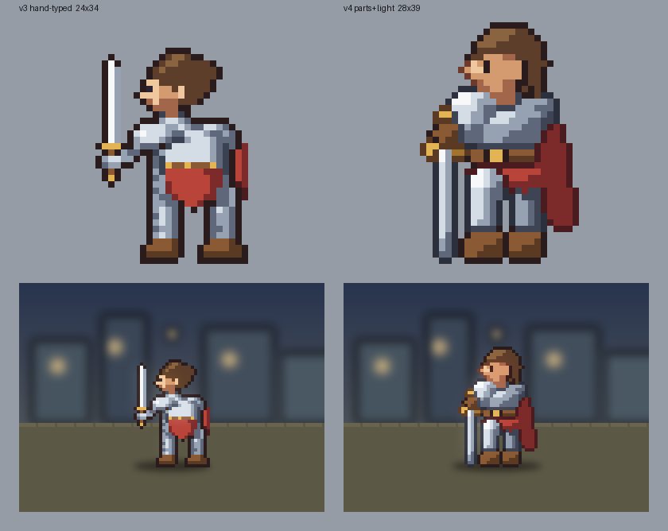
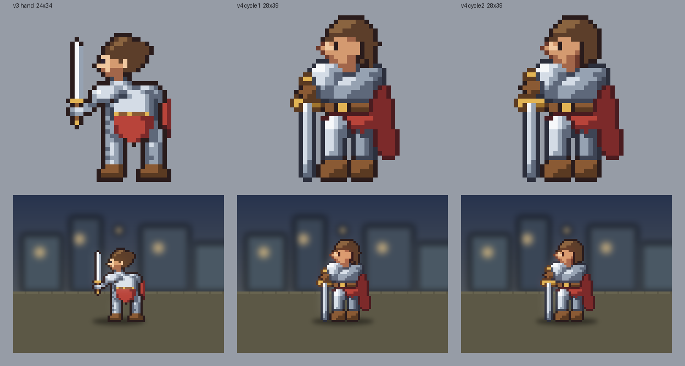
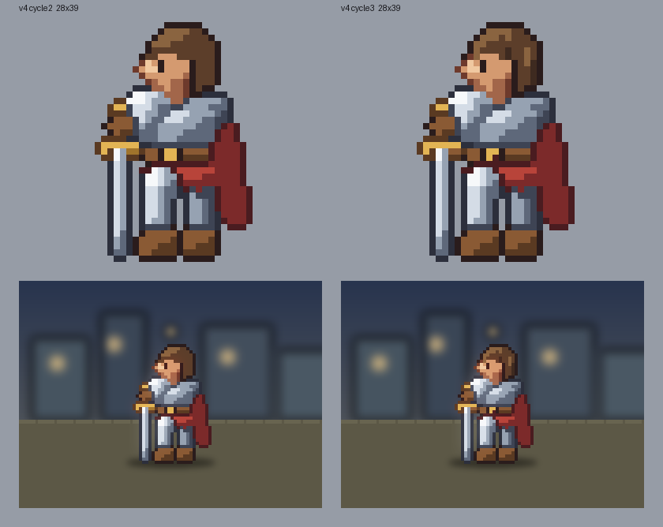
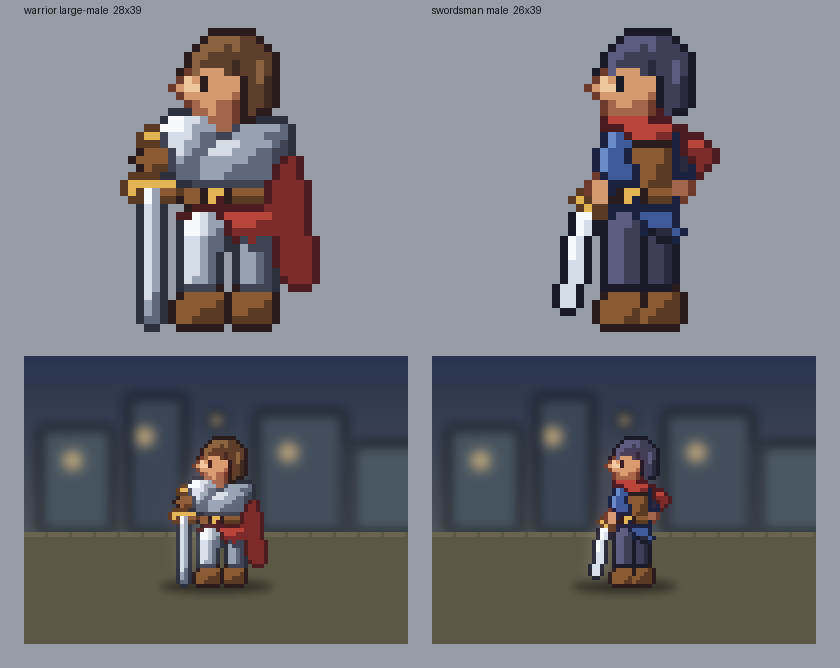
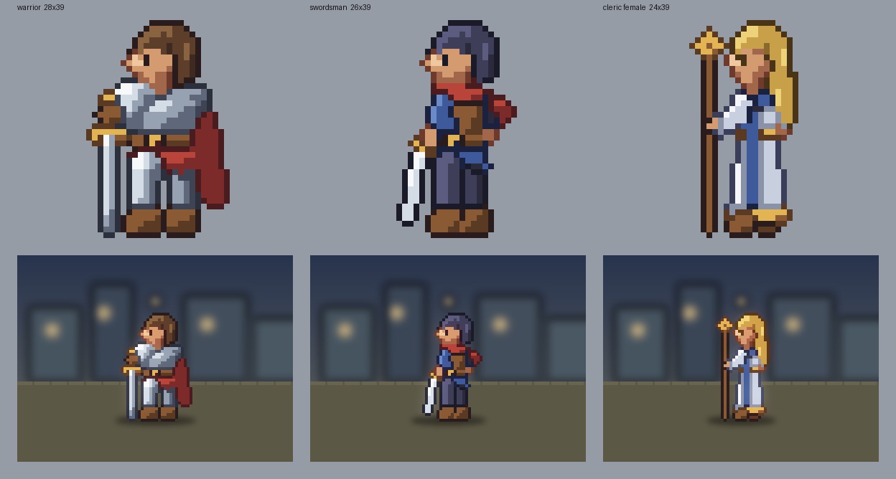

# 進み具合

周ごとの比較画像と、目で見た判定を置く。数字（`tools/check.py`）が通っただけでは良しとしない。
画像は `python3 tools/compare.py <out.png> <ラベル>=<sprite.json> ...` で作る。

## 2026-09-29 戦士 v3（手打ち）と v4（部品組み＋光）

判定: v4 の方が良い。ただし顔と手は v3 に届いていない所が残る。

| 見た所 | v3 手打ち | v4 部品組み |
|---|---|---|
| 鎧の立体 | 明暗が2〜3段で平ら | 肩当て・胸・脚に丸みと鋭い反射が出た |
| 依頼との一致 | 剣を掲げている（依頼は「地に立てて構える」） | 剣を地に立て、柄頭に手を置く |
| 体格 | 細身。大柄男性に見えない | 肩幅が広く重い |
| 外套 | 右端の帯だけ | 奥行きのある面として見える |
| 顔 | 横顔がはっきりしている | 横向きは読めるが幅が広く、髪が兜のように見える |
| 手 | 剣の柄と手が分かれて見える | 柄頭と手が茶色の塊になっている |
| 数えられるもの | 孤立ドット 20（上限 6）で不合格 | 6/6 通過（色数 20、孤立 0、頭身 3.17） |

次に直す所: 顔の幅と髪の形、手と柄頭の見分け。

## 2026-09-29 周2 v4 の顔と手

判定: 周2 の方が良い。差は小さいが、弱点に挙げた3つのうち2つが前に進んだ。

| 見た所 | 周1 | 周2 |
|---|---|---|
| 頭の幅 | 輪郭込み 14 ドット。顔が横に広い | 13 ドット。後頭部を詰め、首も細くした |
| 髪 | 上が丸い兜のよう | 上と後ろにはねを付けた。まだ兜寄り |
| 耳 | 顔と同じ明るさ | 最初に明るくしたら2つ目の目に見えたので、影側の色に落とした |
| 手と柄頭 | 茶色の塊 | 金の柄頭が手の上に出て、剣の柄を握っているのが読める |

次に直す所: 髪の房の表現（段の付け方）、顔の陰影の段数。

## 2026-09-29 周3 髪の房

判定: 周3 の方が良い。髪が一枚の兜から、縦の束に見えるようになった。舞台の図でもうるさくならない。

- 描画器に `strands`（流れに直交する明暗の縞）を足した。前髪は -20 度、後ろ髪は 10 度
- 後ろ髪は中間の明るさに寄っていて、縞の振れ幅 0.14 では段が変わらなかった。0.24 で束が見えた
- 色が 21 に増えたので、金の暗い段を革の明るい段と共有して 20 に戻した

## 2026-09-29 周4 2人目の職業（剣士）

判定: 別の職業・別の体格として読める。戦士の頭と顔を `base` で引き継ぎ、胴から下と装備を差し替えた。

- 良い所: 肩当てと外套が無く細身。青い上着・革の胴着・赤い襟巻きで、戦士と色の印象が分かれる。舞台の図でも見分けられる
- 弱い所: 顔が戦士と同じ。男性の枠なのに頭が戦士と同じ大きさで、少し幼く見える。剣身の上の段が曲がって見える
- 斜めの細い剣は、縮小に任せると鎖のように途切れた。仕上がりの格子で線を引く `pixline` を足して直した

## 2026-09-29 周5 女性の枠（神官）

判定: 3人とも輪郭と色で見分けられる。神官は剣士の差し替えをさらに差し替えて作った（継承の2段）。

- 良い所: 白い法衣に青い肩掛けと縦の帯、金の裾と杖頭。長い金髪に房の縞。肩幅が狭く、女性の枠に見える
- 直した所: 杖が顔に重なったので前へ離した。戦士から引き継いだ鼻の突き出しが男性的だったので、神官は鼻を出さずにまつ毛を足した
- 長い髪を頭に数えると頭身が 2.00 になった。後ろ髪は `head: false` にして、頭は前髪の上端から顎までで数える
- 弱い所: 3人とも頭の大きさが同じ（12 ドット）。体格の枠ごとの差がまだ胴から下だけ
