# 進み具合

周ごとの比較画像と、目で見た判定を置く。数字（`tools/check.py`）が通っただけでは良しとしない。
画像は `python3 tools/compare.py <out.png> <ラベル>=<sprite.json> ...` で作る。

## 2026-09-29 戦士 v3（手打ち）と v4（部品組み＋光）

判定: v4 の方が良い。ただし顔と手は v3 に届いていない所が残る。

| 見た所 | v3 手打ち | v4 部品組み |
|---|---|---|
| 鎧の立体 | 明暗が2〜3段で平ら | 肩当て・胸・脚に丸みと鋭い反射が出た |
| 依頼との一致 | 剣を掲げている（依頼は「地に立てて構える」） | 剣を地に立て、柄頭に手を置く |
| 体格 | 細身。大柄男性に見えない | 肩幅が広く重い |
| 外套 | 右端の帯だけ | 奥行きのある面として見える |
| 顔 | 横顔がはっきりしている | 横向きは読めるが幅が広く、髪が兜のように見える |
| 手 | 剣の柄と手が分かれて見える | 柄頭と手が茶色の塊になっている |
| 数えられるもの | 孤立ドット 20（上限 6）で不合格 | 6/6 通過（色数 20、孤立 0、頭身 3.17） |

次に直す所: 顔の幅と髪の形、手と柄頭の見分け。

## 2026-09-29 周2 v4 の顔と手

判定: 周2 の方が良い。差は小さいが、弱点に挙げた3つのうち2つが前に進んだ。

| 見た所 | 周1 | 周2 |
|---|---|---|
| 頭の幅 | 輪郭込み 14 ドット。顔が横に広い | 13 ドット。後頭部を詰め、首も細くした |
| 髪 | 上が丸い兜のよう | 上と後ろにはねを付けた。まだ兜寄り |
| 耳 | 顔と同じ明るさ | 最初に明るくしたら2つ目の目に見えたので、影側の色に落とした |
| 手と柄頭 | 茶色の塊 | 金の柄頭が手の上に出て、剣の柄を握っているのが読める |

次に直す所: 髪の房の表現（段の付け方）、顔の陰影の段数。

## 2026-09-29 周3 髪の房

判定: 周3 の方が良い。髪が一枚の兜から、縦の束に見えるようになった。舞台の図でもうるさくならない。

- 描画器に `strands`（流れに直交する明暗の縞）を足した。前髪は -20 度、後ろ髪は 10 度
- 後ろ髪は中間の明るさに寄っていて、縞の振れ幅 0.14 では段が変わらなかった。0.24 で束が見えた
- 色が 21 に増えたので、金の暗い段を革の明るい段と共有して 20 に戻した

## 2026-09-29 周4 2人目の職業（剣士）

判定: 別の職業・別の体格として読める。戦士の頭と顔を `base` で引き継ぎ、胴から下と装備を差し替えた。

- 良い所: 肩当てと外套が無く細身。青い上着・革の胴着・赤い襟巻きで、戦士と色の印象が分かれる。舞台の図でも見分けられる
- 弱い所: 顔が戦士と同じ。男性の枠なのに頭が戦士と同じ大きさで、少し幼く見える。剣身の上の段が曲がって見える
- 斜めの細い剣は、縮小に任せると鎖のように途切れた。仕上がりの格子で線を引く `pixline` を足して直した

## 2026-09-29 周5 女性の枠（神官）

判定: 3人とも輪郭と色で見分けられる。神官は剣士の差し替えをさらに差し替えて作った（継承の2段）。

- 良い所: 白い法衣に青い肩掛けと縦の帯、金の裾と杖頭。長い金髪に房の縞。肩幅が狭く、女性の枠に見える
- 直した所: 杖が顔に重なったので前へ離した。戦士から引き継いだ鼻の突き出しが男性的だったので、神官は鼻を出さずにまつ毛を足した
- 長い髪を頭に数えると頭身が 2.00 になった。後ろ髪は `head: false` にして、頭は前髪の上端から顎までで数える
- 弱い所: 3人とも頭の大きさが同じ（12 ドット）。体格の枠ごとの差がまだ胴から下だけ

## 2026-09-29 周7 狩人

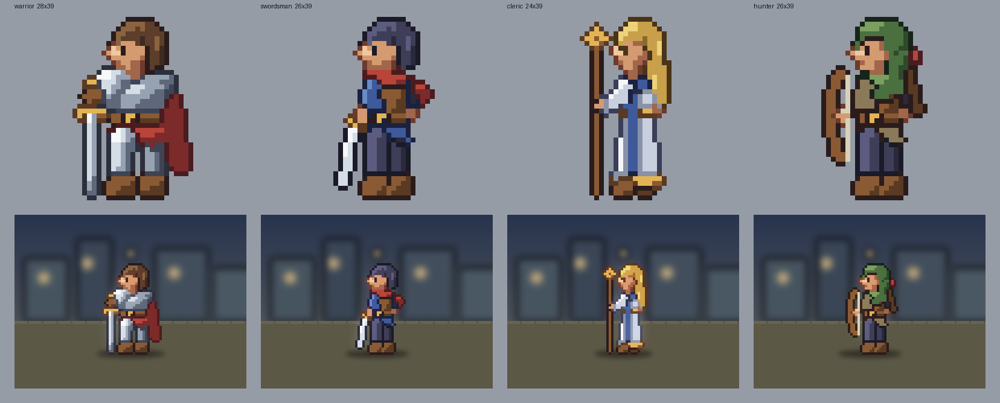

判定: 4人とも輪郭で見分けられる。狩人は緑の頭巾、弓の弧、肩越しの矢筒と赤い矢羽根が目印になる。

- 弓は楕円から右へずらした楕円をくり抜いて弧にし、弦は `pixline` で輪郭なしの1ドット
- 頭巾を1枚で描くと肩まで頭に数えられて頭身が 2.79 になった。頭の上（`head: true`）と垂れ（数えない）に分けた
- 上着まで頭巾と同じ緑にすると一つの塊になった。上着は褐色に分けた
- 弱い所: 男性3人の顔が同じ（同じ鼻と目の位置）。次は顔の描き分け

## 2026-09-29 周8 男性3人の顔

判定: 3人の顔が別人に見えるようになった。

- 戦士: 大きな鼻の突き出しと頬の影（そのまま）
- 剣士: 鼻の突き出しを消して先だけ暗くし、目の上に2ドットの眉。若く鋭い印象
- 狩人: 戦士と同じ鼻を持たせ（剣士の仕上げを継承すると剣士と同じ顔になるため、`touchups` を自分で持つ）、顔全体を1段暗く（`bias -0.12`）して頭巾の影の中に見せた

## 2026-09-29 周9 待機の2コマ

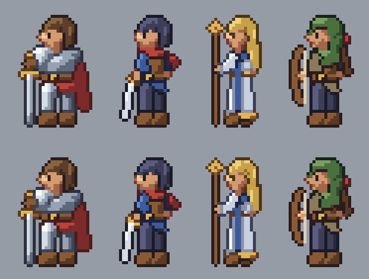

動きは [GIF](2026-09-29-idle.gif) で見る。

判定: 4人とも、頭と肩が1ドット沈む呼吸に見える。脚と足元は動かないので、立ち位置がぶれない。

- 部品ごとに `breathe`（頭と肩 1、胴と腕 0.5、脚 0）を付け、2コマ目は `dy: 1` を掛けた量だけ下げて描く
- 0.5 ドットの動きも高い解像度で動かしてから縮小するので、胴の陰影の変化として出る
- 変わったドット: 戦士 127、剣士 127、神官 104、狩人 130。どのコマも check 6/6

## 2026-09-29 周10 歩きの4コマ

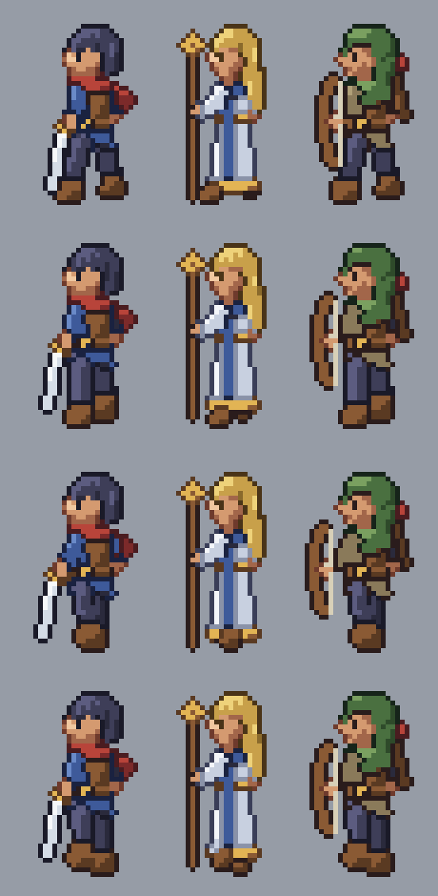

動きは [GIF](2026-09-29-walk.gif) で見る。

判定: 歩いているとは読める。ただし硬い。

- 1・3コマ目で脚を前後に 2 ドットずつ開き、2・4コマ目で片足を上げて体を 1 ドット上げる。腕（と持ち物）は脚と逆に振る
- 剣士と狩人は剣・弓が手と一緒に振れる。神官は法衣の下で靴だけが動く
- 弱い所: 膝が曲がらない（脚が1本の筒のまま）。神官の法衣の裾が揺れない。戦士は剣を地に立てた構えなので歩きを付けていない

## 2026-09-29 周11 歩きの膝と裾

判定: 周10 より良い。上げた足の靴が 2〜3 ドット浮き、踏み出した脚の前の輪郭が膝で折れる。

- 脚を3点（股、膝、足首）の筒にし、コマごとに膝と足首をずらす。上げる脚は膝を前へ 1.6、足を 2.4 上げる
- 神官は1・3コマ目で法衣の裾を 0.6 ドット左右に振る（変わったドット 19 と 25）
- 膝を曲げたコマで、膝の間に背景が1ドットだけ覗いた。上下左右を塞がれた1ドットの穴を埋める処理（`fill_pinholes`）を足した。
  神官の基本のコマでも、杖頭と髪の間の穴が1つ埋まった

## 2026-09-29 周12 右向き

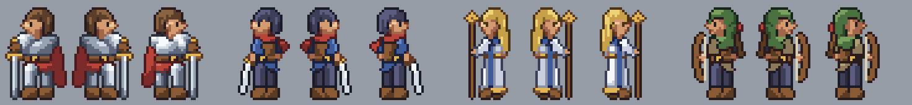

判定: 描き直した右向きの方が良い。絵を反転すると光まで右上から当たり、同じ場面に左右の向きが並ぶと陰影が食い違う。
形だけを反転して描き直せば、どちら向きでも左上から光が当たる（肩当ての明るい面、髪の房の明るい側が左に残る）。

- `frames` に `{"name": "right", "mirror": true}`。書き出しは `sprite.right.json`。4人とも check 6/6
- 仕上げのドット（目、鼻）と房の縞の向きも一緒に反転する

## 2026-09-29 周13 右向きの待機と歩き

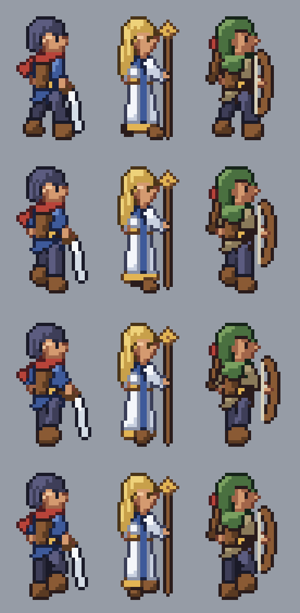

動きは [GIF](2026-09-29-right-walk.gif) で見る。

判定: 左向きのコマから作った右向きの歩きが、右へ踏み出して見える。光は左上のまま。

- parts.json に `mirror_frames: true` を書くと、左向きの全コマから `right-<名前>` を作る。横の動き（`move` の x）は逆にする
- 右向きの待機2コマ目で、戦士と狩人が 21 色になった（外套の明るい段や肌の明るい段が数ドットだけ出た）。
  作風の色数の上限を超えたら、使うドットが最も少ない色をいちばん近い色に寄せる `reduce_colors` を足した。既存のコマは変わらない
- 1人あたり 13 コマ（基本、待機、歩き4、右向き同じ数）。4人の書き出しは合わせて約 10 秒

## 2026-09-29 周14 戦士の歩き

動きは [GIF](2026-09-29-warrior-walk.gif) で見る。

判定: 剣を地に立てたまま歩かせると杖を引きずるように見えるので、歩きのコマだけ剣を立てて両手で持つ構えに差し替えた。重い剣を前に立てて進む姿に見える。

- コマに `override`（そのコマだけ部品を差し替える）を足した。左向きの座標で書き、右向きは自動で反転する
- 膝を曲げるため脚を3点にした。直線上に点を足しただけだが、立ち姿でも膝の内側が1ドット出た（変わったドット 5）。膝当てに見えるので残した

## 2026-09-29 周15 踊子

判定: 神官と同じ女性の枠で、別の職業に見える。赤い巻き布の下衣（房の縞で布の流れ）、後ろへ流れる金の飾り帯、前へ伸ばした素肌の腕と金の腕輪。

- 神官を継承（3段目）。法衣を下衣に差し替え、裾の揺れの歩きもそのまま引き継いだ
- 素肌の腕が素肌の胴に溶けたので、同じ素材どうしでも手前の部品に `line_same` があれば境目の線を引くようにした
- 弱い所: 金の胸当てが小さく、腕に隠れて読みにくい。腕を胸の高さに上げた構えは何かを抱えているように見えたので前へ伸ばした

## 2026-09-29 周16 盗賊

判定: 同じ男性の枠の3人が、頭（紺の髪、緑の頭巾、銀の髪に赤い鉢巻き）と持ち物で見分けられる。

- 剣士を継承。口元まで覆う深緑の襟巻き、灰紫の上着、逆手の短剣、後ろへ流れる鉢巻きの端
- 鉢巻きを最初に頭の上端に置いたら帽子のつばに見えたので、額の高さへ 1 ドット下げた
- 弱い所: 短剣が小さく、脚の前で白い線に見える程度。銀の髪は明るい段が広く、やや兜に見える

## 2026-09-29 周17 子供の枠（商人の少女）

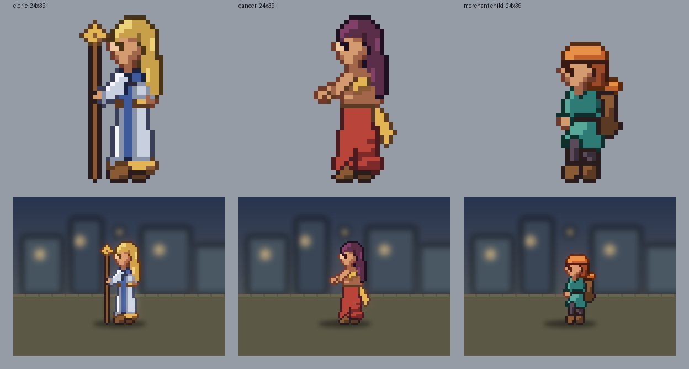

歩きは [GIF](2026-09-29-merchant-walk.gif)。

判定: 大人の女性2人と並べて、はっきり子供に見える。橙の帽子と背の大きな荷で、商人の輪郭になっている。

- 描画器に `transforms`（部品の拡大縮小）を足した。全体を幅 0.9・高さ 0.8 に縮めてから、頭だけを 1.08・1.1 に戻す。目や口の仕上げのドットも同じ規則で動かす
- 体の芯は 12x32 で大人の幅の下限 14 を下回った。作風の決まりに子供の枠の範囲（幅 10〜18、高さ 26〜34）を足し、`frame: "child"` のスプライトはその範囲で数える
- 頭身 2.91（大人は 3.17）。子供の頭の比率が大きいことが数字にも出る

## 2026-09-29 周18 学者、8人の並び

判定: 学者は金の短髪、眼鏡、臙脂の長い上着と白い襟、青い本で読める。8人が並んでも輪郭と色で見分けられる。

- 眼鏡の玉の色が上限を超えて金に寄せられ、黄色い眼鏡になった。白い襟と同じ白を使い、縁は紺の輪郭の色と共有して 20 色に収めた
- 腕を内へ抱えたので体の芯が 13 ドットになった。長い上着の裾を左へ広げて 14 にした（裾の広がりとして自然な範囲）
- 眼鏡の仕上げのドットの横で地のドットが孤立した。仕上げの後にもう一度孤立ドットを掃除するようにした（ほかの職業でも目の周りの 1〜4 ドットが整った）
- 弱い所: 学者と神官がどちらも金髪で、並べると頭の色が重なる

## 2026-09-29 周19 薬師（職業の一覧がそろう）

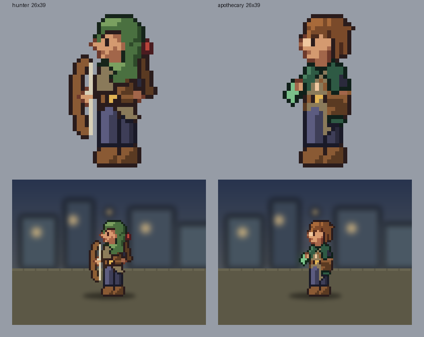

判定: 薬師として読める。はねた栗色の髪、深緑の上着、手の緑の薬瓶、腰の鞄。同じ緑系の狩人とは、頭巾の有無と持ち物で見分けられる。

- 弱い所: 生成りの前掛けが、腕・鞄・帯に隠れて細い帯にしか見えない。胸を渡る革の帯も上着の色に沈む
- 髪のはねを 1 ドット幅で入れたら上に1本だけ毛が立ったので、はねの先を 0.5 ドット下げた（周3 と同じ失敗。はねは 2 ドット以上の幅で）
- これで道のりの職業8つ（戦士、剣士、狩人、盗賊、学者、神官、踊子、商人、薬師）と体格の枠4つがそろった

## 2026-09-29 周20 覆われた部品を読めるようにする

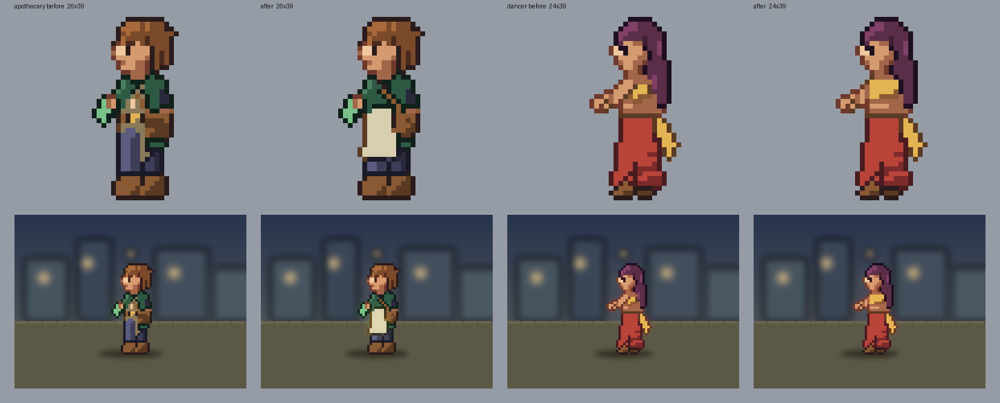

判定: どちらも良くなった。薬師は生成りの前掛けと胸を渡る革の帯がはっきり見え、踊子は金の胸当てが帯として読める。

- 原因は重ね順だった。前掛けが脚より奥にあり、脚に隠れていた。脚の手前（`after: near_leg`）へ移した。踊子の胸当ては腕の手前へ
- 体格の枠ごとの頭の大きさは、今回は変更不要と判断した。男性の枠の頭身は 3.17 で作風の範囲（2.8〜3.4）の中にあり、8人の並びでも男性の頭が大きすぎては見えない

## 2026-09-29 周21 2つ目の作風（16ビット機風 16x24）

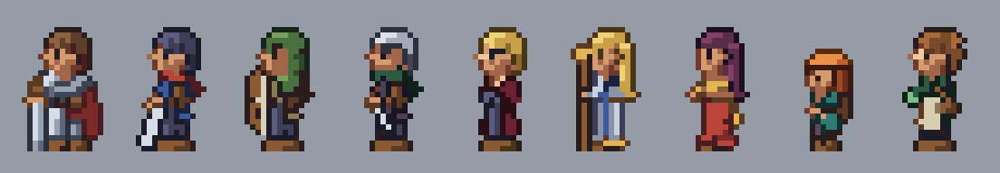

判定: 同じ部品から、頭の大きい 16x24 の 16ビット機風に描き分けられた。9人とも見分けられ、作風の決まり（色 15、孤立 4 以下、頭身 2.0〜2.6）で全員通る。
ただし `styles/retro16.json` の数字は実物を見ずに記憶で置いたもので、本当に 16ビット機 らしいかは実物と並べるまで判定できない（参考サイトに届かない。判断待ち1）。

- 作風ごとの `render`（キャンバス、ずらし、transforms）を書き、`tools/build.py --style retro16` で `<キャラ>/retro16/sprite.json` に書き出す
- 全体を 0.55・0.56 に縮めてから頭（`parts: "head"`）を 1.3 倍に戻す
- 仕上げのドット（目など）の座標を、描き上がりの格子の座標（shift 込み）と形の座標で取り違えていた。形の座標に戻してから動かすように直した。子供の商人の 箱庭ドットの顔の仕上げが 1 ドット動いた

## 2026-09-29 周22 3つ目の作風（2頭身風 16x16）

判定: 2頭身弱の 16x16 に描き分けられ、9人とも頭と色で見分けられる。数字は 16ビット機風と同じく記憶で置いたもの（`unverified: true`）。

- 最初は頭が 6 ドットで小さく、頭身 2.67 で外れた。体を 0.3 に縮めて頭を 2.4 倍に戻し、頭 8 ドット前後にした
- 目・鼻・口の1ドットが孤立ドットに数えられて外れた。仕上げで意図して置いたドットを `intended` として書き出し、検品で数えないようにした（ノイズを数える決まりなので）。既存の絵は1枚も変わっていない
- 9人 × 3作風（箱庭ドット は 12 コマずつ）の書き出しは合わせて約 36 秒

## 2026-09-29 周24 設定資料の色指定

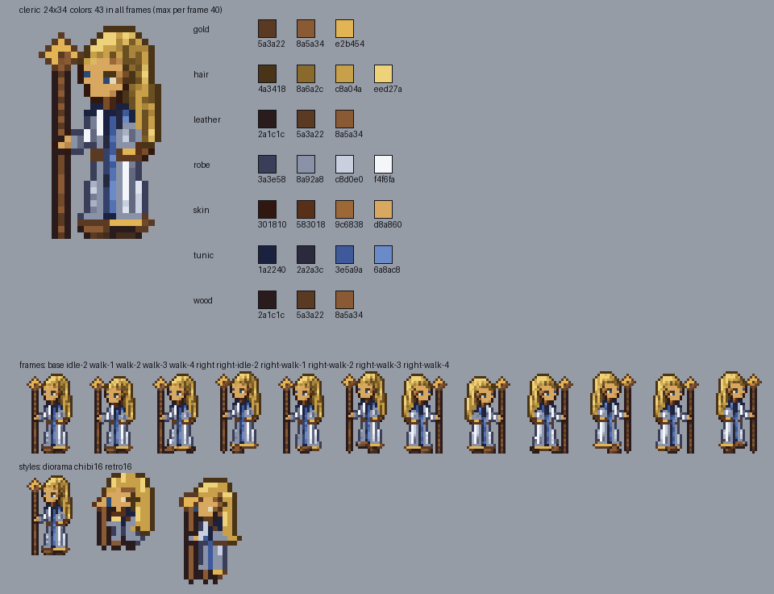

9人分を `docs/sheets/` に置いた。立ち姿の拡大、素材ごとの色見本（輪郭から明るい段へ、16進つき。どのコマでも使っていない段は薄く）、全 12 コマ、3作風の描き分けを1枚にまとめる。

- 判定: 別の人が同じキャラクターを描くとき、色と動きをこの1枚で拾える。色の値は parts.json から読むので、形や色を直しても作り直せば食い違わない
- 神官の上着の明るい段（6a8ac8）はどのコマでも使われていない。段が1つ余っていることが見本で分かる

## 2026-09-30 周26 見た目の弱い所

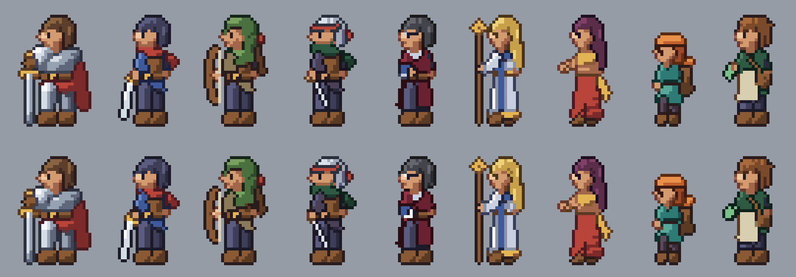

判定: どちらも良くなった。

- 盗賊の短剣を 4 ドット長くして明るくした。脚の前の白い線ではなく、逆手の刃に見える
- 学者の髪を金から黒に変えた。神官（金の長髪）と並べても頭の色が重ならない。眼鏡の白い玉は黒髪の前の方が目立つ

## 2026-09-30 周27 盗賊の銀髪

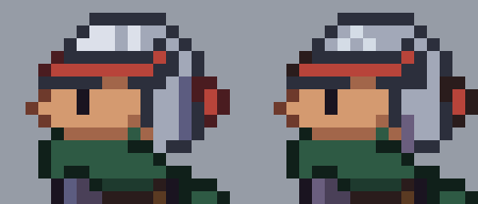

判定: 少し良くなった。頭頂の明るい面が小さくなり、縞で束に割れたので、金属の兜らしさが減った。後ろ髪はまだ平らな灰色で、差は小さい。

- 髪の段の境を上げ（0.42/0.72 → 0.48/0.84）、前髪と後ろ髪に房の縞を足した

## 2026-09-30 周28 3/4 の顔と職業ごとの髪

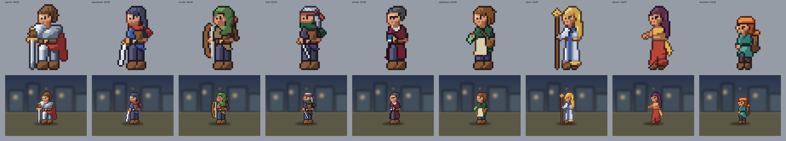

判定: 良くなった。前は全員が真横の輪郭に正面向きの目を1つ置いた顔で、壁画のように見えていた。髪も戦士のおかっぱを皆で使い回していた。

- 顔の前の線をほぼ縦にし、鼻を輪郭から出さずに影1ドットで置いた。奥の目を輪郭寄りに1ドット、手前の目を縦2ドットで置くと、顔が斜めを向いて見える
- 髪: 戦士は短髪、剣士は後ろで束ねた長髪、学者は額を出した七三。狩人と盗賊は頭巾と鉢巻で隠れる
- 判定の比べ先を自分の前の版だけにしていたのが見落としの原因。3/4 の顔として成り立っているかを、形の約束（両目、鼻の置き方）で見る

## 2026-09-30 周29 顔の引き算

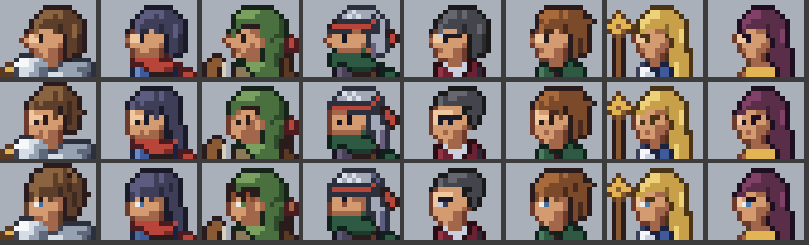

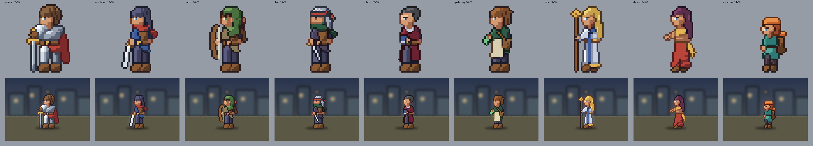

判定: 良くなった。横顔は壁画に見え、3/4 で両目・鼻・口を置いた版は、この大きさでは部品が多すぎて化け物に見えた。

- 実機の立ち絵を拡大して数えた。顔は幅5〜6、高さ4〜5ドットで、前髪が目の上まで下りている。鼻と口は描かず、目は暗い1ドット・瞳の色1ドット・白い光1ドットの塊が1つだけ
- 同じ版に合わせた。鼻・口・奥の目・眉を消し、前髪を目のすぐ上まで下ろし、毛先をギザギザにした
- 頭頂の3ドット幅のこぶは `flatten_crown` で1段下げる（形を1人ずつ直さず、描き上がりで直す）
- まだ弱い所: 髪の中の明るい房の筋が実機より少なく、髪が平らに見える

## 2026-09-30 周30 色の段と影と質感

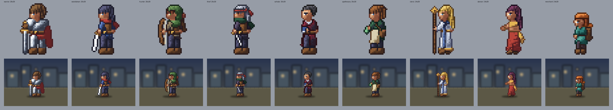

判定: 良くなった。前は色が少なく影が浅く、面が平らで、のっぺりしていた。

実機の立ち絵4人・941体を数えて、自分の絵と並べた。

| 項目 | 実機 | 前 | 後 |
|---|---|---|---|
| 1体の色数 | 28〜40 | 20 | 33〜40 |
| 暗いドット（明るさ 70 未満）の割合 | 0.45〜0.69 | 0.51 前後 | 0.53〜0.72 |
| 隣と色が変わる割合 | 0.80〜0.87 | 0.46〜0.55 | 0.63〜0.80 |
| 孤立ドット | 約2割 | 上限 6 で消していた | 1割強 |

- 色数の上限 20 と孤立ドットの上限 6 は、確かめずに置いた数字だった。これが面の質感を消していた
- 描き方: 各素材の下に輪郭と混ぜた深い影の段、段の間に中間色を足す。明暗の幅を広げ（中心 0.75、2倍）、座標で決まる揺らぎ（0.24）を足して段の境をほぐす。孤立ドットは明るさが大きく外れたものだけ消す
- 検査に「情報量」「色数の下限」を足し、孤立ドットは割合で見る。のっぺりに戻ると数字で落ちる
- まだ弱い所: 隣と色が変わる割合は実機に届いていない。実機の情報量は揺らぎではなく、描き込み（縫い目、板金の継ぎ目、布の皺、髪の房）で出ている。次はここを部品で足す

## 2026-09-30 周31 目の組み方

判定: 良くなった。前は白目を黒目の前に置いていて、横目に見えていた。

- 手前の目は眉2ドット、黒目縦2ドット、黒目の後ろ側に白目1マス。奥の目は暗い1ドットだけ
- 手前の目を1マス前に寄せ、顔の明るい面に乗せた。影の境に置くと沈み、奥の目のほうが目立った
- 肌は明暗の幅を広げない。前の周の変更で、顔の右半分が影に沈んでいた
- 確かめていない: 16ビット機風・2頭身風の目（同じ直しを座標だけずらして当てている）

## 2026-09-30 周32 目の高さを揃え、全コマで確かめる

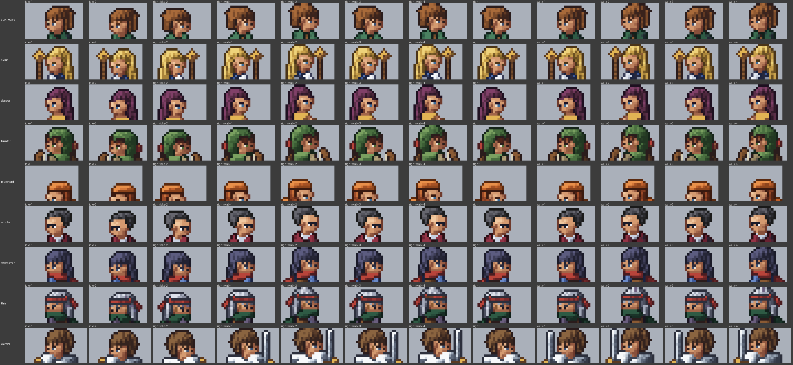

判定: 良くなった。前は黒目が縦2ドットで、白目が上の段にしか付いておらず、目の形が片寄っていた。

- 黒目を1ドットにし、奥の目・白目と同じ行に揃えた
- 最初の1コマしか見ていなかった。`tools/faces.py` で全員の全コマの頭を並べる。右向きの呼吸のコマで、学者の眼鏡の光が消えていた（色数を減らす処理が、守るべきドットまで塗り替えていた）。これを直し、目の直しが全コマに残るかを試験にした

## 2026-09-30 周33 左右の黒目を揃える

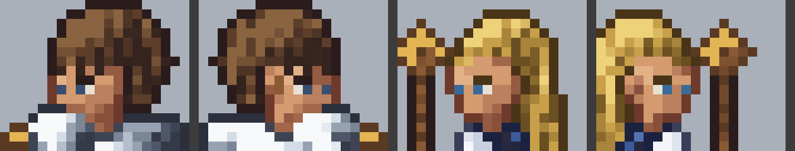

判定: 良くなった。奥の目が髪の輪郭の暗い色、手前の黒目が瞳の色で、左右の黒目が別物に見えていた。

- 奥の目も手前の黒目と同じ色にし、同じ行に置く（全員、全コマ）
- 色を寄せたあとに孤立ドットが増えることがあったので、寄せたあとにも掃除をかける

## 2026-09-30 周34 手本と並べて目と肌を直す

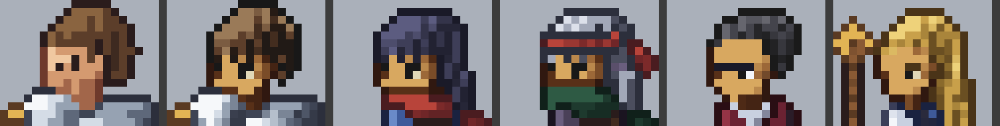

判定: 良くなった。前の周までは手本を横に置かず、自分の前の版とだけ比べて直していた。

- 手本の立ち絵2体の頭を1ドットずつ文字に起こし（`tools/vsref.py --dump`）、同じ倍率で横に並べた（`tools/vsref.py`）
- 目の行を手本どおり「輪郭・奥の目・肌・肌・黒目・白目」にし、眉を黒目と白目の真上に置いた。黒目は黒
- 肌の段を手本の並べ方（黒の輪郭、最も暗い茶、暗い茶、中間、明るい黄土）にした。桃色に寄っていた
- まだ弱い所: 髪。手本は暗い地に明るい房が細かく散り、縁がほつれている。次の周で同じやり方で直す
- 体の高さ: 手本は体 33px・頭 11px。戦士は体 38px。頭身の範囲に収めるため頭を 12px のままにした

## 2026-09-30 周35 見下ろす視点の目

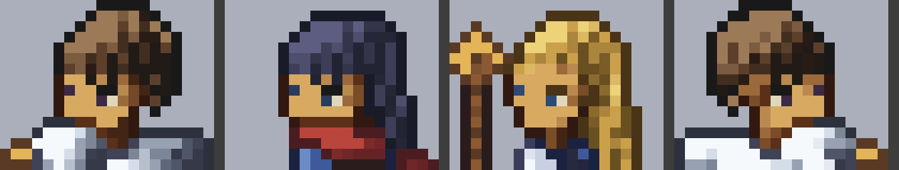

判定: 良くなった。この作風は斜め上から見下ろす視点で、奥の目は手前の目より1段上にずれ、黒目は黒でなく瞳の色だけで置く。手本の文字起こしにこの情報はあったのに、奥の目を「奥の眉」と読み違えていた。

- 奥の目を1段上げ、瞳の色1ドットにした。手前の黒目も黒をやめ、暗い瞳の色にした
- 見下ろす視点は体にも出ている（胴の向き、帯の弧、構え、脚の短さ）。次の周で手本と並べて直す

## 2026-09-30 周36 脚を手本の割合に縮める

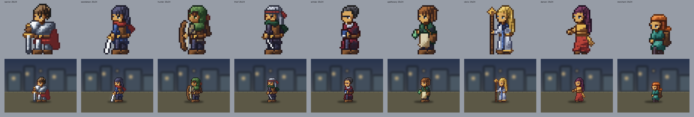

判定: 良くなった。手本の戦士は全身31行のうち頭11・胴8・腰7・脚5で、自分の戦士は脚とブーツだけで12行あった。

- 変形に `below` を足し、腰（y=25）より下だけを 0.62 倍に縮めた。上半身と目の直しはそのまま。戦士を土台にする職業にも効く
- 頭身の範囲 2.8〜3.4 は確かめずに置いた数字だった。手本を数えると大人 2.5〜2.9 なので 2.4〜3.1 に直した
- まだ弱い所: 構え（手本は足を開き、拳を大きく構える）、胴の向き（胸の前面と両肩）、服のひだの縦縞

## 2026-09-30 周37 服のひだ

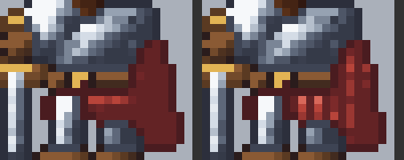

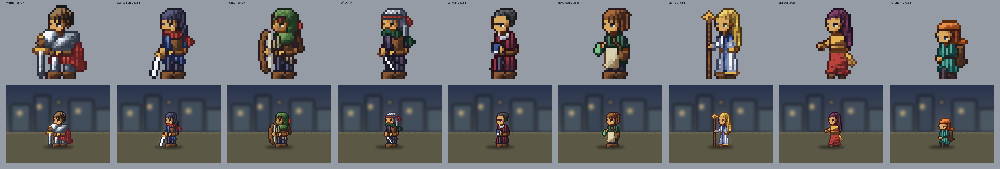

判定: 良くなった。手本の服は1ドットおきの縦縞（布のひだ）で情報量を出している。自分の服は平らな面だった。

- 素材に `folds`（縦縞、2ドット周期、強さ 0.3）を足し、上着・ズボン・法衣・腰布・マントにかけた。隣と色が変わる割合は 0.63〜0.73 → 0.64〜0.81
- 強さ 0.12 では影の中で段をまたげず、縞が見えなかった
- 猟師の頭巾は縦縞で緑の髪に見えたので外した。頭を包む布は頭の丸みに沿うので縦のひだは合わない
- まだ弱い所: 構え（足を開き拳を大きく）、胴の向き（胸と両肩）
