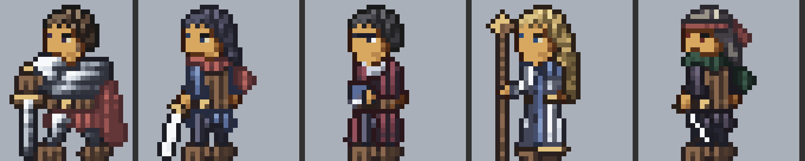
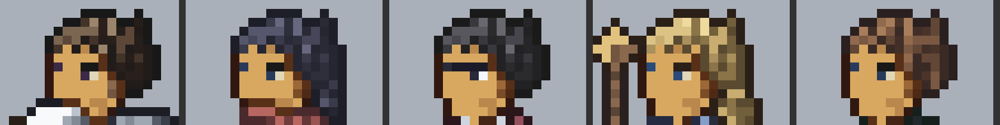
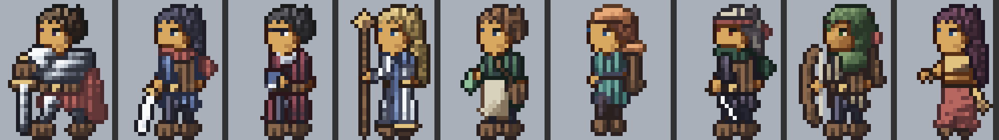

# 2026-10-03

対象は 2026-09-30 09:00 JST から 2026-10-03 09:00 JST まで。作業があったのは 9/30 から 10/1 05:00 までで、10/1 と 10/2 の定期実行はセッションが休止していて動かなかった（10/1 の月報と 10/2 の日報は無い。月報は今日 `docs/reports/monthly/2026-10.md` に書いた）。

やったこと: 利用者の指摘（顔が壁画・化け物、色が少なく平ら、人間の体を理解していない）を受け、手本を拡大して1ドットずつ読む進め方に切り替えた。並べる道具（`tools/vsref.py`、`tools/faces.py`）を作り、目の組み方、人間本体の土台（`tools/body.py`、5体型）、頭の作り（頭蓋骨＋顔＋沿う髪）、細くなる手足（`limb`）、輪郭の色、彩度、素材の描き込み、額、髪の房、靴の底、足の開きを直した。PR #31〜#61

良くなったこと:
- 顔: 鼻・口・奥の白目を消し、手前の目は「眉2ドット・黒目・白目1ドット」、奥の目は1段上の瞳の色1ドットにした
- 頭の縦の割り振りを手本（髪4・額2・眉・目・目の下3）に合わせ、髪が顔より大きく見えるのを減らした
- 足元: 9職業すべてで靴の底の輪郭が画面の下端で切れていたのを直し、剣士の系統は左右の靴の間に背景を見せた

AI 精度: 手本4体（941 コマ）を数えた数字に寄せた。色数 28〜40、頭身 2.4〜3.1（手本の実測 2.5〜2.9）、孤立ドットの割合 0.08〜0.3、隣と色が変わる割合は手本 0.80〜0.87 に対してこちら 0.70〜0.79 で、まだ届いていない。見た目の判定は手本と同じ倍率で並べて行った

直したバグ:
- 靴が画面の最下行を越え、底の輪郭が切れていた（9職業）。体の高さが短く数えられ、頭身の検査がそれで通っていた
- 商人の足元が画面の外にあった（自分の変形で足元を固定したまま、戦士の1行下げを受け継いでいた）
- 仕上げのドット（眼鏡の光など）が減色で別の色に塗り替えられていた
- 減色のあとに新しい孤立ドットが出ていた
- 頭頂に1〜3ドットのこぶが出ていた（`flatten_crown`）

テスト: 26 件 OK（14.1 秒）。足した試験: 最下行に明るい色が無いこと（直す前の main では 81 枚が落ちる）、目の仕上げの色が全コマに残ること、体型の土台が書き出しと一致すること、手足が付け根から先へ細くなること、頭頂のこぶを下げること。9/30 に一度、試験が落ちたまま push した（#56。土台の書き出し忘れ）。次のコミットで直し、コミットを試験の終了コードで分岐する形にした

知識: `docs/knowledge/` の tech（目の組み方、足し算と引き算、質感、ひだ、輪郭はほぼ黒、彩度、髪の輪郭、画面の下端、足の開き）、anatomy（人体の比率、頭の縦の割り振り）、decisions に追記。`docs/references.md`（参考にした作品と出典）を新設

GitHub: PR #31〜#61 の 31 本を作り、すべてマージした。開いている PR は無い

Actions: 0 回（ワークフローが無い。検証はすべて手元）

残り:
- 隣と色が変わる割合（情報量）が手本より低い
- 胴と腕の境目: 手本は腕の輪郭が胴から分かれて見えるが、こちらは腕が胴に溶ける
- 頭頂の房、明るい毛筋
- 戦士・僧侶・商人・踊り子の足の開き
- 盗賊の瞳が赤茶になる（減色で瞳の色が近い色に寄る）

判断待ち:
3. 道のり3（等身の高いイラスト）の作り方。推す案は A（今の部品の仕組みの延長）
4. 進捗の図のうち手本の切り抜きが入った5枚。推す案は、自分のスプライトだけの図に差し替える（履歴の書き換えはしない）

次に優先するもの:
1. 胴と腕の境目を手本に合わせる（腕の外形の輪郭、袖の段）
2. 隣と色が変わる割合を手本の 0.80 に近づける（布と革の描き込み）
3. 判断待ち4に答えがあれば、それに従って図を差し替える
